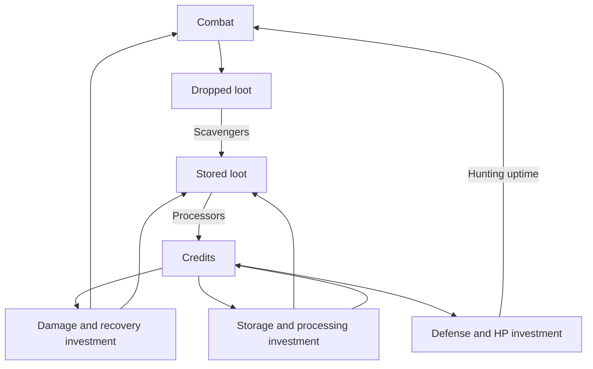

# Living game design

Updated: 2026-11-02. This document describes intent. See [PROJECT_STATE](PROJECT_STATE.md) and [v0.5](v0.5.md) for implemented behavior, [DECISIONS](DECISIONS.md) for commitments, and [BACKLOG](BACKLOG.md) for work.

## Game in one sentence

Build an automated clone workforce, identify its current bottleneck, change the allocation or investment, and watch the whole operation improve.

The experience should reward understanding the numbers. Repeated screen navigation should not be the difficulty. Mobile play, a compact interface, the ruined-mall pixel aesthetic and identical clone identity remain central.

## Design pillars

1. **Visible cause and effect.** A change to fighting, recovery, storage, processing or survival has understandable consequences for sustained income.
2. **Convenient decisions.** The relevant values and controls are accessible together, while detailed screens remain useful.
3. **Several useful investments.** More damage is not the universal answer. Supply, throughput, capacity and survival create different bottlenecks.
4. **Recoverable setbacks.** A wipe should motivate better allocation, with a clear route back into the loop. The specific consequence is still being explored.
5. **One person, many clones.** Face, body, proportions and clothing are shared. Only the role accessory changes.

## Connected loop

The diagram expresses the desired decision relationships. Survival already exists in the prototype, but making its trade-off compelling is pending work.

## Balance vocabulary

“Loot is low” must be diagnosed rather than treated as one condition. Stored amount, maximum capacity and flow rate are different quantities.

| Situation | Possible cause | Candidate response to evaluate |
| --- | --- | --- |
| Storage is empty; processors wait | Enemy supply or recovery is below processing demand | Improve combat/recovery, or move an unnecessary processor |
| Ground loot accumulates; storage has room | Scavenging capacity is limiting recovery | Add scavengers or shared scavenging training |
| Stored loot accumulates toward full | Processing is below recovered input | Add processing capacity; more generation alone worsens the backlog |
| Small storage repeatedly fills during bursts | Capacity cannot absorb arrival timing | Increase storage, compare with processing investment |
| Damage is high but wipes are frequent | Poor survival reduces productive uptime | Compare HP/defense investment with further damage |

These are hypotheses to verify against the state, not automatic recommendations from one number. Both small storage capacity and low stored inventory are captured from the user's “loot cap is low” feedback.

For a measurement window `T`, track:

- Loot generated = sum of drops from completed defeats.
- Loot recovered = movement from ground stock into stored stock.
- Loot processed = stock consumed by processing.
- Actual credits/sec = credits produced / T; net income additionally subtracts spending or any future wipe cost.
- Hunting uptime = time actively fighting / T. Sustained output includes recovery periods.
- Conservation: initial ground + initial stored + generated = final ground + final stored + processed + discarded.

Current prices, caps, formulas and temporary test counts remain in the implementation/release record. New target rates, timings and penalty amounts require a documented balance experiment; no replacement numbers are selected here.

## Use MDA to test design choices

| Layer | Clone Shift application |
| --- | --- |
| Mechanics: rules and controls | Assignments, capacity, costs, damage, HP, recovery, upgrades |
| Dynamics: behavior produced by the rules | Supply shortages, processing backlogs, storage waste, damage/survival trade-offs |
| Player experience | “I understand the bottleneck, make a choice, and can see why the operation improves” |

Evaluate changes from the desired experience back to the rules. A higher penalty is useful only if it produces an interesting and understandable decision.

## Framework sources and adaptation

This project uses a small combination of practices, not a mandatory engine or a claim that every studio works identically:

- [Hunicke, LeBlanc and Zubek: MDA](https://www.cs.northwestern.edu/~hunicke/MDA.pdf): relate mechanics, emerging behavior and player experience.
- [Unity: one-page game design document](https://unity.com/blog/one-page-game-design-document): keep the essential game plan short and update it as learning changes the project.
- [Machinations: framework basics](https://machinations.io/docs/framework-basics): reason about resource creation, pools, conversion and flows. We adopt the modelling vocabulary; this does not require a Machinations subscription or project.

Research checked 2026-11-02. The project-specific pillars, backlog, AI handoff and asset process are our adaptation. A simple status board and decision log provide continuity without a large production-management system.
